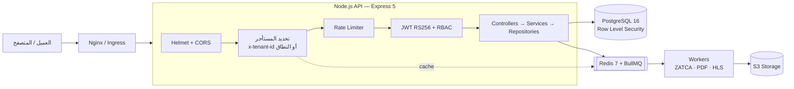
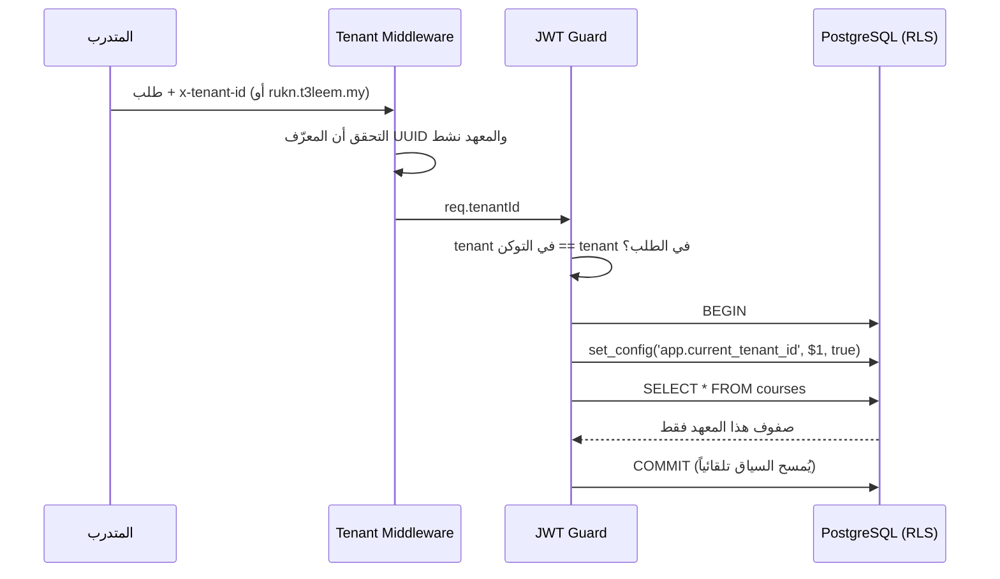
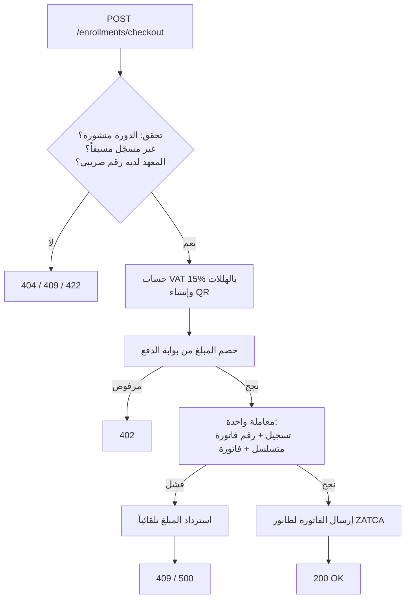

# T3leem.my — منصة التدريب السحابية (Backend)

منصة **SaaS متعددة المستأجرين** تتيح للمعاهد والشركات التدريبية إطلاق أكاديمية رقمية كاملة بهويتها الخاصة (White-label): دورات مسجلة وبث مباشر عبر Zoom، حماية الفيديو، فوترة إلكترونية متوافقة مع **ZATCA المرحلة الثانية**، وشهادات رقمية قابلة للتحقق عبر QR.

> المستودع يحتوي تطبيقين:
> - **الجذر:** الخادم الخلفي (Express API).
> - **`web/`:** واجهة الأكاديميات بـ Next.js. لكل معهد موقع بهويته على `/<slug>`، مثل `/rukn`.
>
> دليل النشر على Vercel: [docs/DEPLOY_VERCEL.md](docs/DEPLOY_VERCEL.md)

---

## الحالة الحالية

| المكوّن | الحالة |
|---|---|
| هيكل التطبيق، الأمان، الأخطاء الموحدة | ✅ جاهز |
| قاعدة البيانات PostgreSQL 18 بمستخدمين منفصلي الصلاحيات | ✅ جاهزة مع بيانات تجريبية |
| عزل المستأجرين بـ PostgreSQL RLS | ✅ جاهز ومُختبَر على قاعدة حقيقية (٧ اختبارات) |
| مُرمِّز ZATCA TLV / QR | ✅ جاهز ومطابق لمثال ZATCA الرسمي |
| `POST /api/v1/enrollments/checkout` | ✅ جاهز (ببوابة دفع تجريبية) |
| تسجيل الدخول `POST /api/v1/auth/login` | ✅ جاهز (رموز وصول RS256 لمدة ١٥ دقيقة، بدون رموز تجديد بعد) |
| كتالوج الدورات `GET /api/v1/courses` وبيانات المعهد `GET /api/v1/tenant` | ✅ جاهز |
| واجهة Next.js: الأكاديمية، الدورة، الدخول، الشراء مع رمز QR | ✅ جاهزة |
| دليل مزودي الخدمة في الصفحة الرئيسية `GET /api/v1/platform/providers` | ✅ جاهز |
| لوحة تحكم المزود `/api/v1/admin/*` و`/<slug>/dashboard`: الدورات (الترخيص، الاعتماد، الساعات، المدة)، المدربون، المتدربون، الخطط التدريبية والتطويرية، الفصول الافتراضية | ✅ جاهزة، مع سجل تدقيق لكل عملية |
| تعديل وحذف المدربين والمتدربين والخطط والفصول والدورات (مع منع حذف ما له تسجيلات أو فواتير) | ✅ جاهز |
| ربط Zoom: إنشاء الاجتماع ورابطه تلقائياً، ومزامنة الموعد، وحذفه عند الإلغاء | ✅ جاهز، ويعمل عند ضبط بيانات Zoom (انظر أدناه) |
| تسجيل مزود خدمة جديد ذاتياً `/join` | ✅ جاهز |
| الهوية والإعدادات `PUT /api/v1/tenant/branding`: الاسم، الألوان، النبذة، الشعار، الاسم القانوني والرقم الضريبي | ✅ جاهز |
| بوابة دفع حقيقية (Mada / HyperPay) | ⏳ تحتاج بيانات التاجر |
| توقيع ZATCA (XML + ECDSA) وإرسال الفواتير | ⏳ الطابور جاهز، العامل (Worker) لم يُكتب |
| تسجيل المتدرب ذاتياً `POST /api/v1/auth/register` | ✅ جاهز |
| بوابة المتدرب: دوراتي، التقدم بالدروس، الجلسات المباشرة | ✅ جاهزة |
| الفيديو المحمي: رفع ← تحويل خلفي إلى HLS مشفّر AES-128 ← روابط تشغيل موقّعة ومؤقتة ← مفتاح يُعاد التحقق من التسجيل عند كل طلب | ✅ جاهز ومُختبَر بفك تشفير حقيقي |
| الشهادات: إصدار تلقائي عند إكمال الدورة + QR + صفحة تحقق عامة `GET /api/v1/certificates/verify/:code` + طباعة/PDF | ✅ جاهزة |
| إشعارات Zoom: التحقق من التوقيع، تسجيل الحضور، استيراد التسجيلات كدروس محمية | ✅ جاهزة |
| النطاق الخاص لكل أكاديمية مع إثبات الملكية عبر DNS | ✅ جاهز |
| رموز التجديد (Refresh Tokens)، تخزين S3، إبلاغ ZATCA الفعلي | ⏳ لم تُبنَ بعد |

---

## البنية المعمارية

نمط **Modular Monolith**: تطبيق واحد مقسّم إلى وحدات مستقلة يمكن فصل أي منها لاحقاً كخدمة مستقلة.



### كيف يعمل عزل المستأجرين (أهم جزء في النظام)

كل جدول يحمل `tenant_id`، وقاعدة البيانات نفسها — وليس كود التطبيق — هي من تمنع قراءة بيانات معهد آخر:



- القيمة تُمرَّر **كمعامل** وليس كنص داخل SQL ← لا يمكن حقن SQL عبر الترويسة.
- السياق **محلي للمعاملة** ← لا يتسرّب بين الطلبات عبر اتصالات الـ Pool.
- التوكن مربوط بالمعهد ← تغيير `x-tenant-id` يدوياً يُرفض بـ 403.
- استعلام بدون سياق يُرجع **صفر صفوف** بدلاً من كل البيانات.

### تدفق الدفع والتسجيل



---

## هيكل المجلدات

```text
src/
├── app.ts                    # بناء تطبيق Express (بدون اتصالات — قابل للاختبار)
├── server.ts                 # نقطة التشغيل وربط البنية التحتية + الإيقاف الآمن
├── config/                   # env (Zod) · database (RLS) · redis
├── modules/
│   ├── tenant/               # تحديد المعهد من المعرّف/النطاق مع Cache
│   ├── lms/enrollments/      # الدفع والتسجيل (Controller → Service → Repository)
│   ├── billing/              # واجهة بوابة الدفع + بوابة تجريبية
│   └── zatca/                # حساب الفاتورة المبسطة
└── shared/
    ├── middlewares/          # المستأجر · JWT/RBAC · Rate Limit · التحقق · الأخطاء
    ├── services/             # Winston Logger · BullMQ Producer
    └── utils/                # ZatcaTlvEncoder · المبالغ · الأخطاء الموحدة
prisma/
├── schema.prisma             # نموذج البيانات
├── migrations/               # الترحيل الأولي
└── rls/001_enable_rls.sql    # سياسات العزل
tests/
├── unit/                     # الخدمات والمرمّز والمبالغ
└── integration/              # عقد الـ API + عزل RLS على قاعدة حقيقية
```

---

## الفيديو المحمي

1. من لوحة التحكم ← الدورة ← **إدارة المحتوى والفيديو** ← أضف درس فيديو وارفع الملف (MP4/MOV/WebM/MKV).
2. يتحقق الخادم من أن الملف فيديو حقيقي، ثم يحوّله في الخلفية بـ FFmpeg (مضمّن عبر `ffmpeg-static`) إلى HLS بمقاطع ٦ ثوانٍ مشفّرة بـ AES-128.
3. مفتاح التشفير يُخزَّن مشفّراً بـ AES-256-GCM في قاعدة البيانات، ويُسلَّم فقط عبر رابط موقّع لمدة ساعتين، وبعد التحقق المباشر من أن المتدرب ما زال مسجّلاً.

بدون Redis تعمل المعالجة داخل الخادم نفسه. مع Redis شغّل عاملاً منفصلاً حتى لا يتأثر الخادم:

```powershell
npm run worker
```

## ربط Zoom (اختياري)

بدون إعداد يلصق المزود رابط الاجتماع يدوياً. لتفعيل الإنشاء التلقائي:

1. في [Zoom Marketplace](https://marketplace.zoom.us) أنشئ تطبيقاً من نوع **Server-to-Server OAuth**.
2. امنحه صلاحيات: `meeting:write:meeting:admin` و`meeting:update:meeting:admin` و`meeting:delete:meeting:admin`.
3. ضع القيم في `.env`: `ZOOM_ACCOUNT_ID` و`ZOOM_CLIENT_ID` و`ZOOM_CLIENT_SECRET`، ثم أعد تشغيل الخادم.

بعدها: عند جدولة فصل على Zoom دون رابط يُنشأ الاجتماع تلقائياً (غرفة انتظار، تسجيل سحابي)، ويُحدَّث عند تغيير الموعد، ويُحذف عند الإلغاء أو الحذف. رابط المضيف لا يُخزَّن ولا يُعرض أبداً.

**إشعارات Zoom (الحضور والتسجيلات):** في تطبيق Zoom فعّل Event Subscriptions بالأحداث `meeting.participant_joined` و`recording.completed`، واجعل العنوان `https://<api>/api/v1/webhooks/zoom`، وضع **Secret Token** في `ZOOM_WEBHOOK_SECRET_TOKEN`. كل إشعار يُتحقق من توقيعه (HMAC-SHA256) ويُرفض إن كان أقدم من ٥ دقائق.

## التقنيات

| الطبقة | التقنية |
|---|---|
| التشغيل | Node.js 20+ · TypeScript (Strict) |
| الإطار | Express 5 |
| قاعدة البيانات | PostgreSQL 16 + Prisma 6 + Row Level Security |
| الطوابير والـ Cache | Redis 7 + BullMQ |
| الأمان | JWT RS256 · Helmet · express-validator · rate-limiter-flexible |
| السجلات | Winston (JSON منظم) |
| الاختبارات | Jest · Supertest |

---

## قاعدة البيانات

| العنصر | القيمة |
|---|---|
| الخادم | PostgreSQL 18 |
| القاعدة الرئيسية | `t3leem` (UTF-8، مزوّد اللغة المدمج `C.UTF-8`، توقيت UTC) |
| قاعدة الاختبارات | `t3leem_test` منفصلة تماماً |
| `t3leem_owner` | مالك الجداول، للترحيلات فقط |
| `t3leem_app` | المستخدم الذي يتصل به التطبيق: قراءة وكتابة فقط، لا يستطيع إنشاء جداول أو تجاوز العزل |

حدود أمان على مستخدم التطبيق: أي استعلام يتجاوز ٣٠ ثانية يُلغى، وأي معاملة منسية تُغلق بعد ٦٠ ثانية، وبحد أقصى ١٠٠ اتصال.

## التشغيل محلياً

```powershell
npm install
npm run db:setup          # يطلب كلمة مرور postgres مرة واحدة، وينشئ القاعدتين والمستخدمين و .env
npm run db:migrate        # الجداول وسياسات العزل
npm run db:migrate:test   # نفس الشيء لقاعدة الاختبارات
npm run db:seed           # بيانات تجريبية: أكاديمية ركن والمسار للتدريب المالي
npm run dev               # الخادم على http://localhost:3000

# الواجهة (في طرفية ثانية)
cd web
npm install
copy .env.example .env.local
npm run dev               # http://localhost:3001/rukn
```

> ⚠️ يجب أن يتصل التطبيق بقاعدة البيانات بمستخدم **ليس Superuser وليس لديه BYPASSRLS**، وإلا تُتجاهل سياسات العزل بصمت. سكربت `db:setup` يضمن ذلك.

### بيانات تجريبية

كلمة المرور لجميع المستخدمين: `Demo@2026`

| المعهد | المعرّف | المستخدمون | الدورات |
|---|---|---|---|
| أكاديمية ركن | `7d1c1a52-3b55-4c0f-9a8a-1b5b6f0c2e11` | `admin@` · `trainer@` · `learner@rukn.test` | PMP (١٠٠٠ ر.س) · الأمن السيبراني (١٥٠٠) · Power BI (غير منشورة) |
| المسار للتدريب المالي | `0b9f4e6a-2c1d-4e8f-8a7b-6c5d4e3f2a10` | `admin@` · `trainer@` · `learner@masar.test` | المحاسبة المالية IFRS (٨٠٠) |

### تجربة الشراء

```powershell
npm run token:dev -- learner@rukn.test   # رمز دخول مؤقت للتطوير (إلى أن تُبنى وحدة تسجيل الدخول)
```

ثم أرسل `POST /api/v1/enrollments/checkout` بالترويسة `x-tenant-id` والرمز، كما في المثال أدناه. Redis اختياري محلياً؛ بدونه تكتمل العملية وتبقى الفاتورة بحالة `PENDING_ZATCA`.

### الاختبارات

```bash
npm test                      # الوحدة + عقد الـ API (لا تحتاج قاعدة بيانات)
npm run test:coverage

# اختبار العزل على قاعدة PostgreSQL حقيقية
TEST_DATABASE_URL=postgresql://... npm run test:integration
```

---

## مثال: عقد نقطة الدفع

```http
POST /api/v1/enrollments/checkout
x-tenant-id: 7d1c1a52-3b55-4c0f-9a8a-1b5b6f0c2e11
Authorization: Bearer <JWT>
Idempotency-Key: 6f1e...   (اختياري)

{ "course_id": "c0a80121-...", "payment_method": "MADA", "payment_token": "tok_mada_..." }
```

```json
{
  "success": true,
  "data": {
    "enrollment_id": "e581f122-...",
    "status": "ACTIVE",
    "invoice": {
      "invoice_number": "INV-2026-00892",
      "total_amount": 1150,
      "vat_amount": 150,
      "zatca_qr_base64": "AQ..."
    }
  }
}
```

الأخطاء بصيغة موحدة: `{ "success": false, "error": { "code": "...", "message": "..." } }`

| الرمز | المعنى |
|---|---|
| 400 | لا يوجد معهد / معرّف غير صالح / JSON تالف |
| 401 | توكن مفقود أو منتهي أو مزوّر |
| 402 | الدفع مرفوض |
| 403 | معهد موقوف / توكن لمعهد آخر / صلاحية غير كافية |
| 404 | الدورة غير موجودة (أو لمعهد آخر) |
| 409 | مسجّل مسبقاً / المعهد بدون رقم ضريبي |
| 422 | بيانات غير صالحة / دورة مجانية |
| 429 | تجاوز حد الطلبات |
